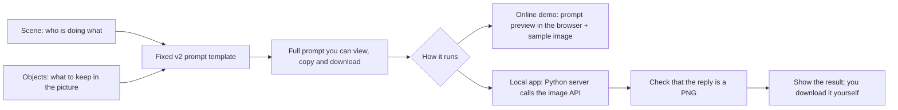

# How the pet doodle tool is designed

How a pet moment becomes an image prompt, why the prompt looks this way, and which files to change when reusing the code. There is no trained model: the app fills a fixed prompt template and sends it to an image model.

## From input to image

**Each input has one job.** The scene gives the action and who is involved, for example "I walk my dog as it chases falling leaves". The object list limits what is drawn, for example "one person, one dog, one leash, two leaves". Your text goes into the prompt as written, not summarized, translated or guessed, so results are easier to repeat and you see exactly what is sent.

## Why the v2 prompt

The first prompt's images had too much background and detail. v2 also asks for a square 1:1 canvas, thin black lines on white, lots of empty space and only the listed objects, and it rules out trees, grass, horizon lines, shading and fur texture. The sample image was made with this prompt.

`prompts/reference-v2.txt` is the only copy of the template. With the default scene and objects, the built prompt matches it exactly. A custom scene replaces just two fixed spans, and the sentence about the dog becomes a sentence about "any pet", so a cat scene is not told to draw a dog. User text is never run as code and is never searched for placeholders a second time.

A prompt cannot guarantee correct legs, object counts or layout, and the sample is not a promise of identical output. Before switching models, run the same scenes through both and compare legs, object count, background clutter and line style.

## Two ways to run it

- **Online demo (static files):** builds the prompt in the browser and shows the existing sample image. No API key, no paid generation, no analytics; your text goes nowhere, though the host may keep access logs.
- **Local app:** a Python server builds the prompt. With your key in the server's environment, Generate sends the prompt to the image API. The key never reaches the browser.

Neither stores what you type.

## File map

| File | What it does | What to change when reusing it |
|---|---|---|
| `static/index.html` | Page layout: inputs, prompt, image and design notes | Product name, input fields and text |
| `static/styles.css` | Paper look, thin lines, spacing, responsive layout | Your app's fonts and colors |
| `static/app.js` | Page state, preview, requests, errors, downloads | Your backend address and sign-in flow |
| `prompts/reference-v2.txt` | The chosen style template | Keep a copy before changing the style |
| `prompt_builder.py` | Input checks and template filling | Your own pet fields |
| `app.py` | Local HTTP server, key, image API call, reply checks | Add user accounts and quotas for production |
| `demo/demo-adapter.js` | Builds the prompt in the browser for the static demo | Only for a demo mode that does not call the paid API |
| `scripts/build_demo.py` | Builds the static demo files from the same template | Point the output folder at your own static host |
| `tests/` | Default-prompt match, input limits and fake-provider tests | Add your own scenes and failure cases |

## Adding it to a pet companion app

1. Add a "Turn into a doodle" button next to a diary entry. Pass the pet type, action and objects the user has confirmed to the prompt function. Do not quietly add personal details.
2. Send the full prompt to your own server. Keep the API key in the server's secret store or environment, never in the mobile app or web page.
3. Let the server call the image model, check the reply, and return the image. The current code asks for exactly one PNG and never retries a paid request on its own.
4. Save the result as a diary attachment the user can change or delete. This prototype only downloads files; accounts, cloud sync, long-term storage and quotas are not built.

The local server is for one person on one computer. A multi-user product needs its own backend for sign-in, per-user limits, budgets, safe retries, data retention and error monitoring.

## What is covered and what is not

Reusable: page layout, prompt rules and building, image request and error handling, tests. Shown to work: the sample image and the local and demo page behavior.

No real paid API call has been made from this project, and it is not known whether the original app used the same model. Diary summaries, image recognition, voice, long-term pet memory and the rest of the original app are not part of this project.

Run, build and deploy: [README](../README.md). Security: [SECURITY](../SECURITY.md).
