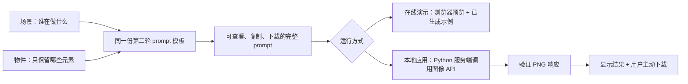

# 这套宠物涂鸦工具是怎么设计的

这个项目把一个宠物陪伴瞬间转成可控的图片描述，再交给图像模型绘制。它不是从安装包还原出的完整原产品，也没有训练自己的绘画模型。我们实际复用了第二轮试验中选定的 prompt，自己实现了输入、预览、接口、错误处理、下载和展示流程。

## 从输入到图片

**两个输入各司其职。** 场景负责动作和关系，比如“我牵着小狗追落叶”；物件列表限制构图，比如“一个人、一只狗、一根绳、两片叶子”。当前版本不自动总结、翻译或推断日记，输入的描述会直接加入 prompt。这让效果更容易复现，也让用户知道哪些文字会发送给模型。

## 为什么是第二轮 prompt

第一轮试验虽然指定了圆珠笔涂鸦风格，画面仍出现较多背景与细节。第二轮进一步指定了 1:1 画布、纯黑细线、白底、大量留白和严格的物件范围，同时排除树、草、地平线、阴影与毛发纹理。当前示例图来自那次实际生成。

`prompts/reference-v2.txt` 是这份模板的唯一参考源。默认场景和物件构建出的 prompt 与它逐字一致。自定义场景只替换两个固定位置，并把指向狗的末句改成通用宠物描述，避免猫咪场景又被要求画狗。用户输入不会被当作代码执行，也不会参与第二次模板替换。

Prompt 能约束画风，但不能保证模型每次都画对肢体、物件数量或构图。示例也不是固定输出承诺。将来更换模型时，应使用同一组场景做对照，检查四足、元素数量、背景复杂度和线条风格，再决定是否替换。

## 两种运行方式

| | 在线静态演示 | 本地完整应用 |
|---|---|---|
| 编辑场景、查看 prompt | 浏览器内完成 | 本机 Python 服务组合 |
| 示例图 | 已生成的同一张示例，明确标识 | 默认显示同一张示例 |
| 新图生成 | 不提供付费生成入口 | 配置自己的密钥后主动调用 |
| API 密钥 | 没有 | 仅后端环境变量 |
| 日记存储 | 应用不持久化输入 | 应用不持久化输入 |
| 网络请求 | 静态文件加载 | 静态文件、本地 API；点击生成后访问图像服务 |

在线演示不会把编辑内容发送给图像模型，也没有接入分析脚本。托管平台仍可能记录普通页面访问，不能据此声称网站完全没有访问日志。

## 文件地图

| 文件 | 职责 | 复用时怎么改 |
|---|---|---|
| `static/index.html` | 输入、提示词、图片和设计说明的页面结构 | 替换产品名称、输入字段和文案 |
| `static/styles.css` | 白纸、细线、留白、响应式布局 | 接入自己 APP 的字体与颜色 |
| `static/app.js` | 交互状态、预览、请求、错误、下载 | 接入自己的后端地址与身份流程 |
| `prompts/reference-v2.txt` | 选定的画风模板 | 改画风前保留一份对照模板 |
| `prompt_builder.py` | 本地输入校验与模板组合 | 接入自己的宠物信息字段 |
| `app.py` | 本机 HTTP 服务、密钥、图像 API、响应检查 | 生产环境应另加用户身份与配额 |
| `demo/demo-adapter.js` | 静态演示的浏览器 prompt 组合 | 只用于不调用付费 API 的展示模式 |
| `scripts/build_demo.py` | 从同一模板生成可部署的静态文件 | 输出目录可交给自己的静态托管 |
| `tests/` | 默认一致性、边界与模拟响应测试 | 增加自己的场景和失败情况 |

## 集成到宠物陪伴 APP

1. 在一条日记旁增加“画成小画”的入口。将已经确认的宠物种类、动作和物件交给 prompt 组合函数；不要默默加入私人身份信息。
2. 把完整 prompt 传给你自己的服务端。API 密钥放在服务端密钥管理或环境变量中，不能打包到移动端或网页。
3. 服务端调用图像模型并验证返回内容，再把图片结果交回 APP。当前实现固定请求一张 PNG，不自动重试付费请求。
4. 把结果作为可修改、可删除的日记附件。当前原型仅下载文件；账户、云同步、长期存储和配额尚未实现。

本地服务只面向单人 loopback 使用。上线多人生成时，身份认证、每人限额、账户预算、请求幂等、数据保留和错误监控都应由实际产品后端承担。静态演示不把这个本地服务暴露到互联网。

## 可复用与未覆盖的部分

可以直接复用的是界面结构、prompt 约束、组合方法、图片请求与错误处理思路，以及测试。已验证的效果是仓库里的实际示例图和本地/演示交互。

还没有在这个独立项目中完成真实付费 API 调用，也未证明它与原应用使用相同的服务端模型。日记自动摘要、图片识别、语音、宠物长期记忆和原应用完整功能都不属于当前实现。

运行、构建和部署命令见 [README](../README.md)。安全范围见 [SECURITY](../SECURITY.md)。
